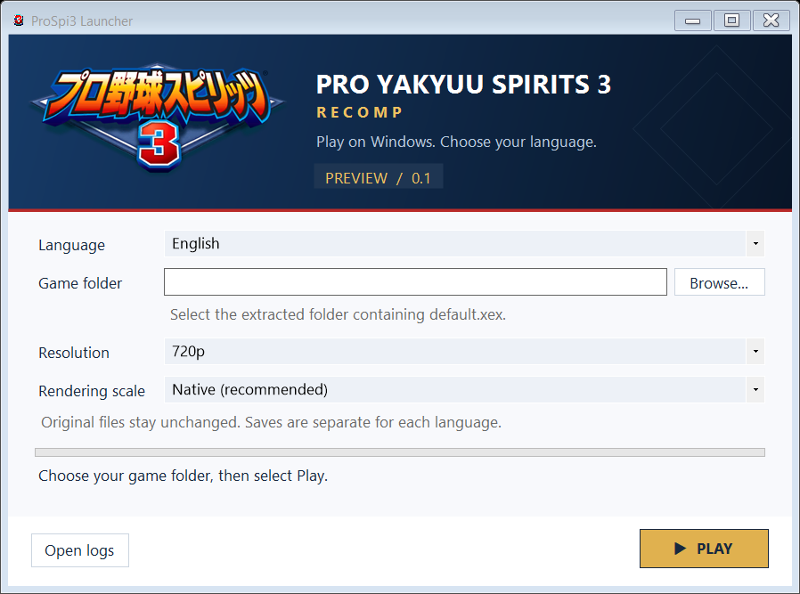

# Pro Yakyuu Spirits 3 Recomp

A Windows port of **Pro Yakyuu Spirits 3** for Xbox 360, built with [ReXGlue](https://github.com/rexglue/rexglue-sdk), with an English localization and the original Japanese mode.

**Windows x64 · Direct3D 12 · Playable preview · English / 日本語**

[Releases](https://github.com/Wndwsqrrl/ProBaseballSpirits3-Recomp/releases) · [Getting started](docs/getting-started.md) · [Known issues](docs/known-issues.md) · [Build from source](docs/building.md) · [Report an issue](https://github.com/Wndwsqrrl/ProBaseballSpirits3-Recomp/issues)

## What this project includes

- Native Windows execution through ReXGlue.
- A launcher with English selected by default and an option for Japanese.
- English menus, gameplay labels, instructions, player names, management reports and event text.
- The original Japanese stadium signs, sponsor ads, ballpark artwork, logos and credits.
- Separate save folders for each language.

The localization is **unfinished**. Some wording, name readings, text placement and less-visited game paths still need review. This preview is not a claim of 100% translation or full-game stability.

## Play the preview

You need your own extracted copy of the **Japanese Xbox 360 release**, containing `default.xex` and `cdvdroot/baseball.fbd`. The original executable and data archive are not included.

1. Extract the Windows preview package from [Releases](https://github.com/Wndwsqrrl/ProBaseballSpirits3-Recomp/releases).
2. Open **ProSpi3 Launcher.exe**.
3. Select your extracted game folder.
4. Choose **English** or **Japanese**, then select **Play**.

English setup creates a separate localized archive from your original files. Japanese uses the original game folder. The launcher does not rewrite your original dump. See [getting started](docs/getting-started.md) for setup, controls and save locations.

## Current status

| Area | Status |
| --- | --- |
| Gameplay | Reaches live gameplay; the latest user test reports good performance. A complete match and every mode have not been exhaustively verified. |
| English text | Broad coverage across menus, gameplay, management and player creation; accuracy and discovery work continue. |
| Pennant events | All 940 populated fields across 187 known events have English and a source/context review. Live layout checks remain. |
| Interface artwork | 2,098 localized label occurrences across 263 atlases; original stadium presentation is preserved. |
| Translation comparison | DeepL responses cover the current known comparison inputs. Manual context review remains in progress. |
| Higher resolution / frame rates | Higher rendering scales are experimental. No high-frame-rate guarantee is made. |

Detailed counts and their limits are in the [coverage status](translation/coverage-status.json), [gap audit](translation/coverage-discovery.md) and [technical notes](docs/technical-notes.md). These inventories are not a full-game completion percentage.

## Supported game version

| Field | Supported value |
| --- | --- |
| Platform / region | Xbox 360 / Japan |
| Title ID | `4B4E07D4` |
| Media ID | `07B4B9D2` |
| Version | `0.0.0.1` |
| `default.xex` SHA-256 | `903E2E94188DA3525C9CA39B9F8D9F27C3F6BEEE25B93A48C90921CDA3D8CDC0` |

Other game revisions are not supported by this preview.

## Help improve the port

For a crash or gameplay problem, include the release version, language, mode, reproduction steps and relevant log. For a translation issue, include a screenshot and where it appears. Please do not attach original game files.

The original Japanese game defines the meaning of the text. Shared terminology is checked against the official 2026 localization where the context matches. Source and gameplay checks guide the review.

## Notices

This is an unofficial fan project, unaffiliated with KONAMI or the game's rights holders. You must supply the original game data. Third-party notices are included under [licenses](licenses/).
