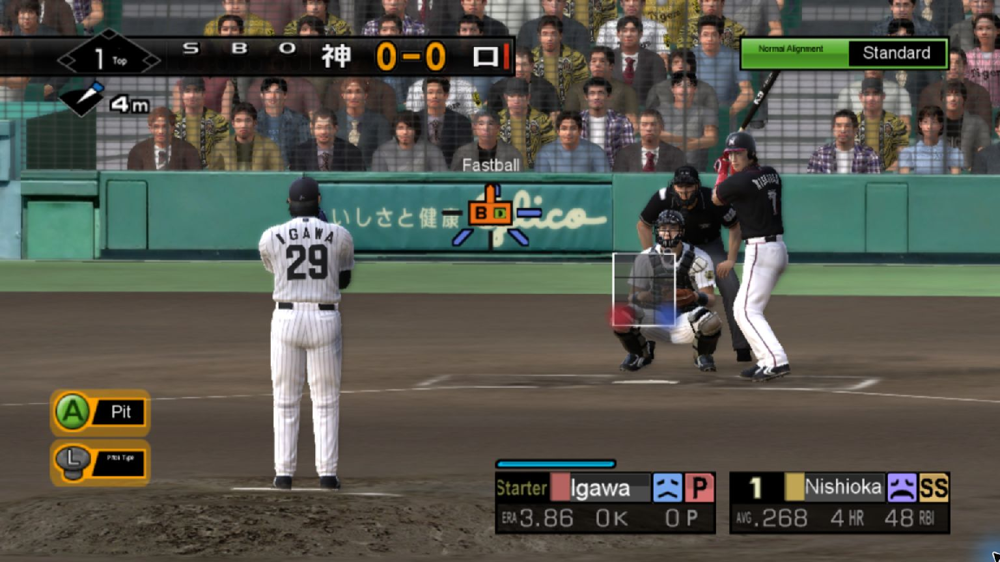
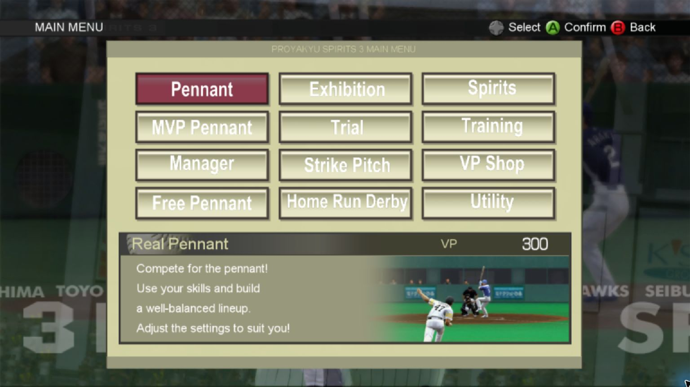
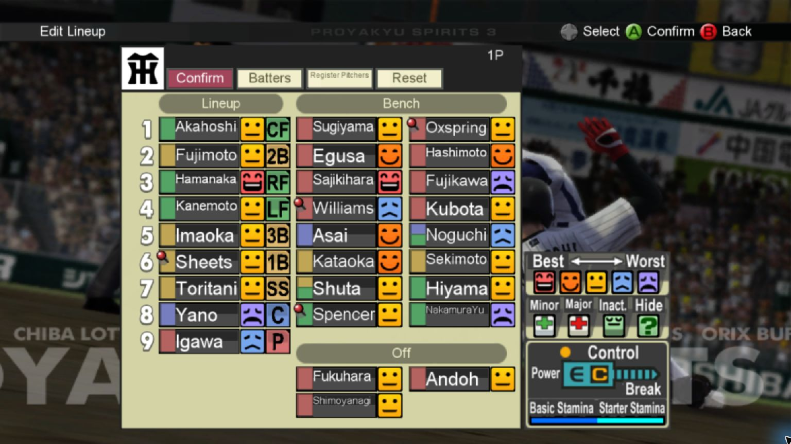

# Pro Yakyuu Spirits 3 Recomp — Windows Preview 0.1

The first Windows preview includes the English localization and the original Japanese mode in one package.

*Live pitching in the English Windows preview, captured November 27, 2026.*

| Choose a mode | Set your lineup |
| :---: | :---: |
|  |  |

All game captures are from November 27, 2026. [View the screenshot gallery](https://github.com/Wndwsqrrl/ProBaseballSpirits3-Recomp/blob/main/docs/screenshots.md) for more menus, player introductions and stadium views.

## Getting started

1. Download and extract the Windows x64 ZIP.
2. Open **ProSpi3 Launcher.exe**.
3. Select your own extracted Japanese Xbox 360 game folder.
4. Choose **English** or **Japanese**, then select **Play**. English is selected by default.

Your game folder must contain `default.xex` and `cdvdroot/baseball.fbd`. The original game executable and archive are not included. The supported `default.xex` SHA-256 is:

`903E2E94188DA3525C9CA39B9F8D9F27C3F6BEEE25B93A48C90921CDA3D8CDC0`

English setup applies a compact patch to a separate generated archive and verifies the result. Your original dump remains unchanged. The package does not require Python or a ReXGlue SDK installation to play. Saves are separate for each language.

Runtime requirements: .NET Framework 4.8 and the [Microsoft Visual C++ x64 Runtime](https://learn.microsoft.com/en-us/cpp/windows/latest-supported-vc-redist). Visual Studio is not required.

## Included

- A launcher using the original game logo, with language and graphics settings.
- Broad English menu, gameplay, management and player-creation coverage.
- English for all 940 populated fields across the known 187-event Pennant resource.
- 2,098 localized interface labels across 263 atlases.
- Team-ID-specific compact labels and improved player-name coverage.
- Original Japanese stadium signs, sponsor ads, ballpark artwork, logos and credits.

## Preview limits

The latest user test reports good gameplay performance. Full-match, every-mode and long-season verification remain incomplete. Localization accuracy, generated-name readings, rare text paths and live text placement are still being reviewed; this is not a 100% translation release.

Start with 720p output and native rendering scale. Experimental 2× and 3× internal rendering scales are available. DLSS/FSR-style upscaling and a verified high-frame-rate mode are not included.

Audio decoding issues and some platform/online-service paths remain unresolved. See the repository's [known issues](https://github.com/Wndwsqrrl/ProBaseballSpirits3-Recomp/blob/main/docs/known-issues.md).

For problems, include the release version, language, reproduction steps and relevant log or screenshot. Do not upload original game files.
