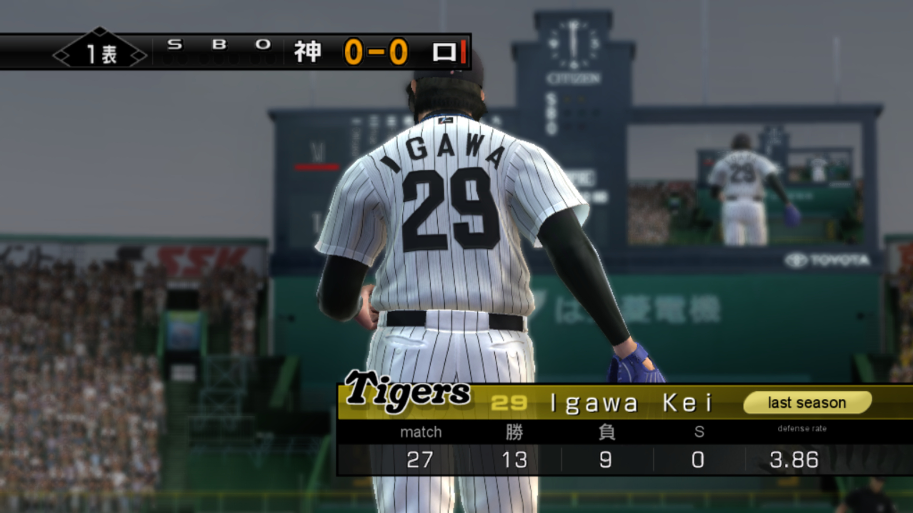
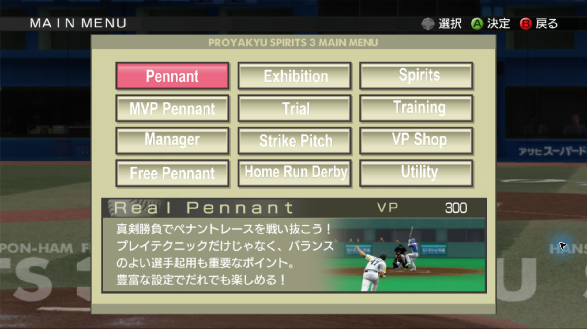
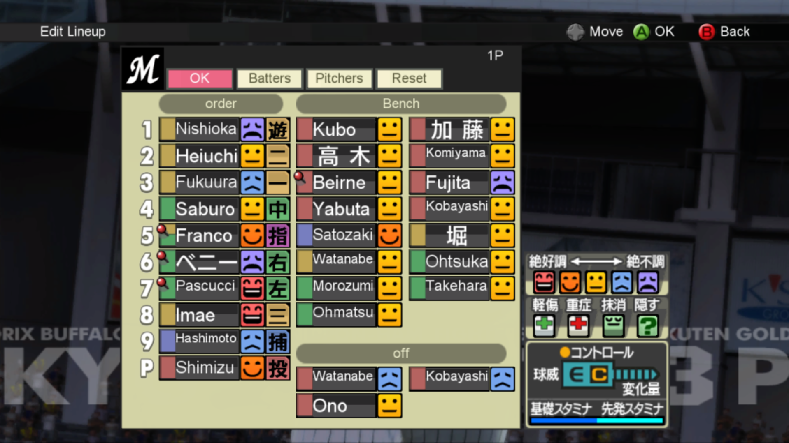
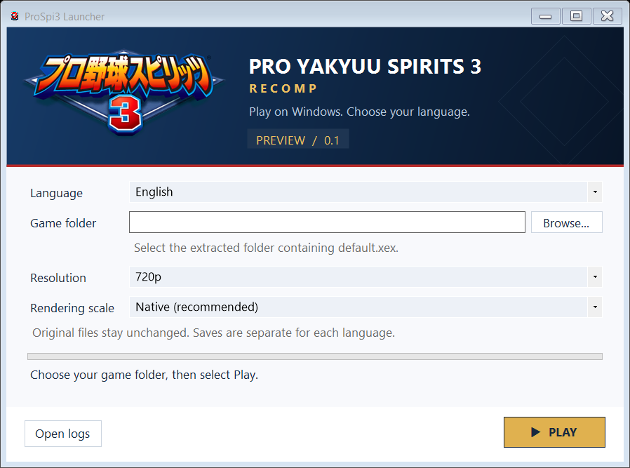

# Screenshots

Actual game captures from development. The images are unedited and retain the original screen dimensions. They show the translation as it appeared on the dates below; the current preview includes later changes.

## Hanshin at the ballpark

November 4, 2026. Kei Igawa's player introduction, with the original Japanese stadium presentation. Some stat labels and wording in this capture predate later localization work.

## Choose a mode

November 3, 2026. English buttons for the game's main modes. The help text and controller legend were still Japanese in this capture.

## Build your lineup

November 3, 2026. English navigation and player names in the lineup editor. Japanese position icons, remaining names and the condition legend show the state of this earlier build.

## Choose your language and graphics settings

November 26, 2026. A rendered preview of the Windows launcher with English selected by default. The original game logo is preserved. English and Japanese use separate save profiles.

The original Japanese stadium signs, sponsor ads, ballpark artwork, logos and credits are intentionally preserved in the localization. Game artwork and trademarks belong to their respective rights holders.

[Back to the project](../README.md) · [Getting started](getting-started.md) · [Known issues](known-issues.md)
