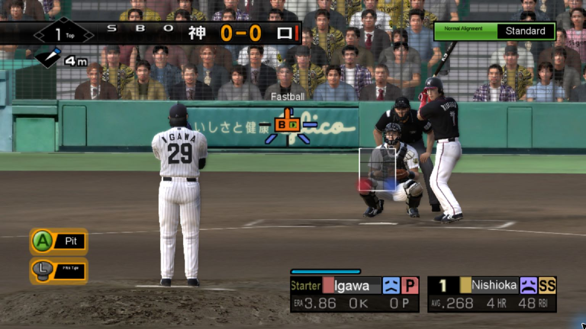
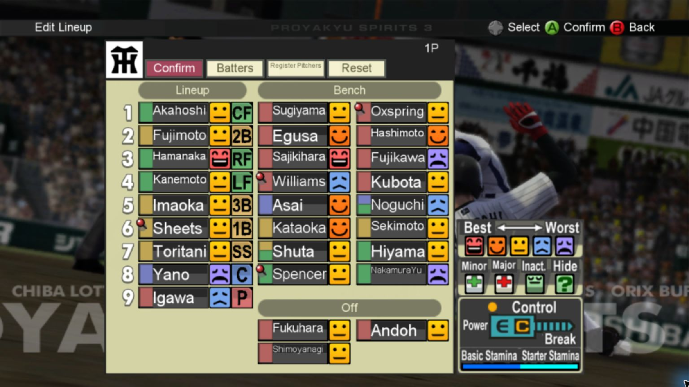
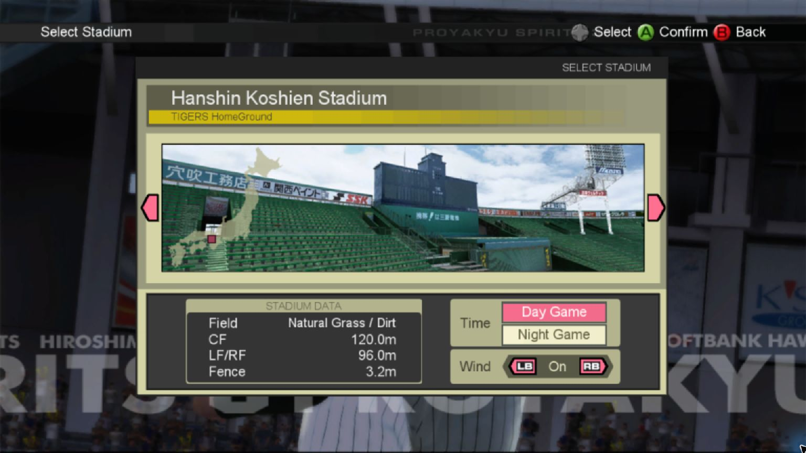
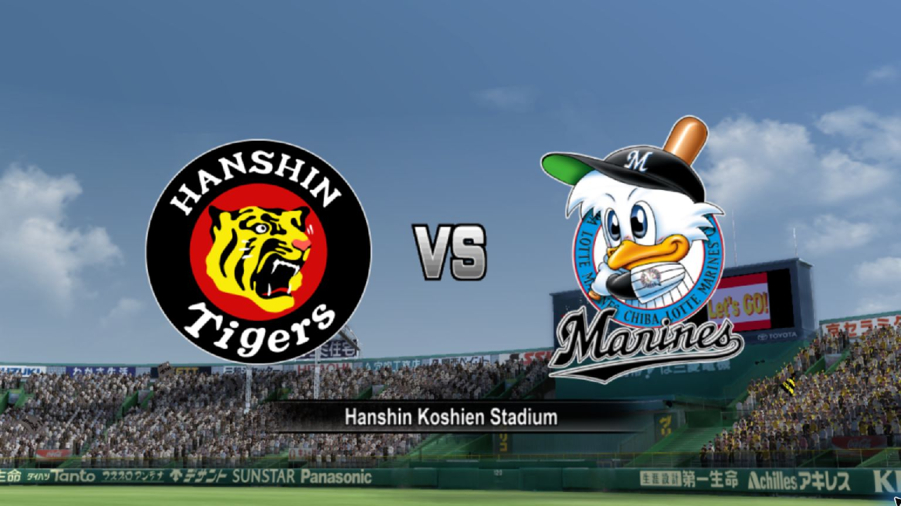
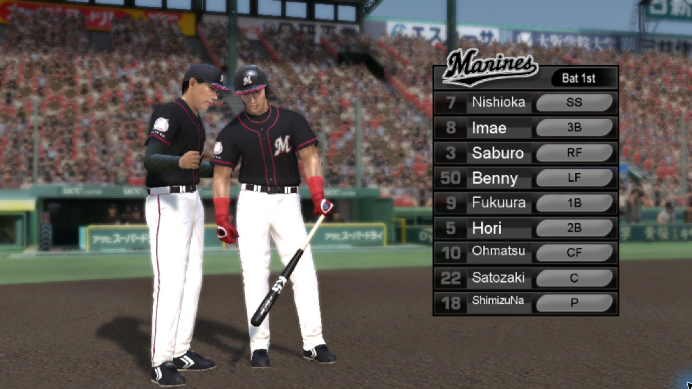
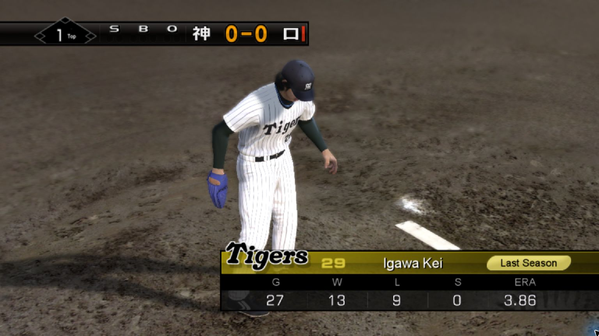
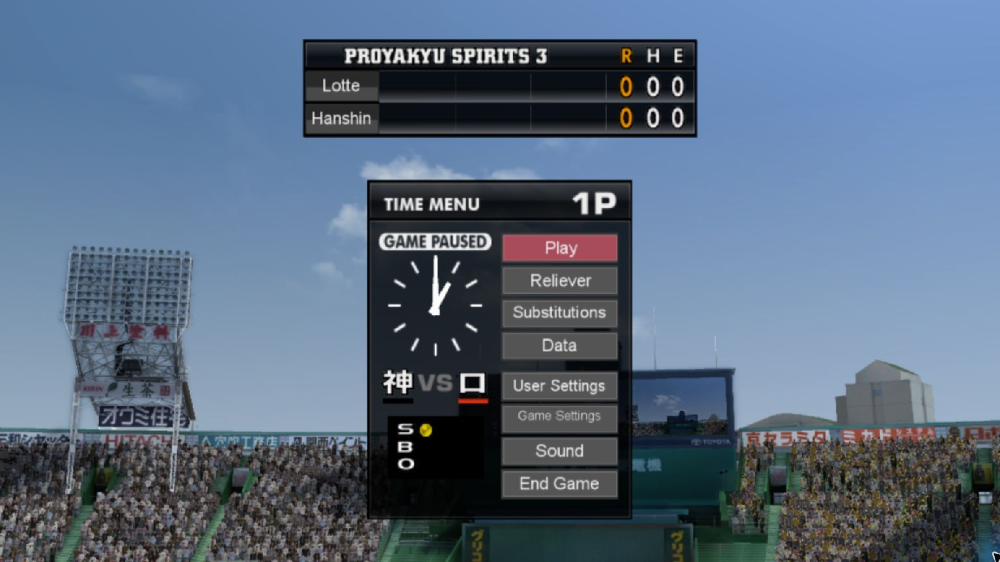

# Screenshots

Fresh window captures from the English Windows preview on **November 27, 2026**. This session launched through **ProSpi3 Launcher.exe**, selected the English files and reached an Exhibition match at Koshien on the NVIDIA GeForce RTX 4050 Laptop GPU.

These captures use the default **720p output setting and native rendering scale**. They have no added or replaced text, cropping, sharpening or image enhancement. They show the current preview, including its remaining translation and placement issues. Capture dimensions and checksums are recorded in [capture details](images/captures.json).

## Live pitching at Koshien

Hanshin's Kei Igawa facing Chiba Lotte's Tsuyoshi Nishioka. English pitch names, player names, positions and stat labels appear alongside the original ballpark advertising. Some compact scoreboard team symbols remain Japanese.

## Choose a mode

The main menu now shows English mode buttons, descriptions and controller prompts.

## Build your lineup

The Hanshin lineup editor includes English player names, position abbreviations and the condition legend. Some longer names and buttons still need placement refinements.

## Pick your ballpark

Koshien's English name, surface, dimensions, time and wind settings, with its original Japanese signs preserved.

## Match introductions

The matchup introduction with an English stadium caption.

Chiba Lotte's pregame lineup, with English names and positions.

Igawa's introduction now uses the compact baseball stat labels **G / W / L / S / ERA**.

## In-game options

The pause menu includes English substitutions, data, settings and sound options.

## Choose your language and graphics settings

A rendered launcher preview from November 26, 2026. English is selected by default; English and Japanese use separate save profiles.

The original Japanese stadium signs, sponsor ads, ballpark artwork, logos and credits are intentionally preserved in the localization. Game artwork and trademarks belong to their respective rights holders.

[Back to the project](../README.md) · [Getting started](getting-started.md) · [Known issues](known-issues.md)
